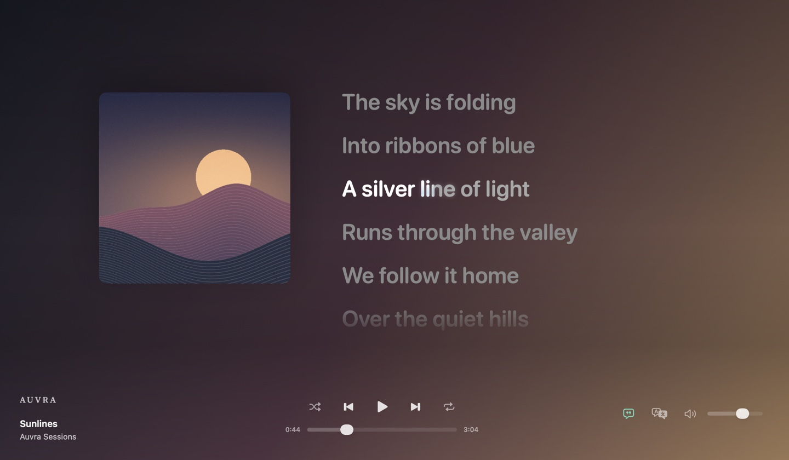

# Auvra

A native music player for Mac that brings your Spotify library and local music into one window. Click the cover to open Now Playing. The background takes its palette from the artwork. When a recording has word timings, the lyrics light up as each word is sung.



*Now Playing with “Sunlines” by Auvra Sessions. The artwork and words were created for this preview.*

## Listening in Auvra

- **Find music.** Search tracks, artists, albums, playlists, podcasts, episodes and audiobooks together. Jump straight to a close artist match or narrow the results with a filter.
- **Pick up where you left off.** Home brings together recent listening, favorites and catalog discoveries. Your Library keeps playlists and Liked Songs within reach. Open the queue from the player bar to see what comes next.
- **Bring your own files.** Open a WAV or FLAC, or add a folder to build a searchable library with embedded artwork. Local playback includes an equalizer, saved volume and a queue that restores on pause.
- **Read along.** Click the lyrics button for synced words, timed lines or plain text, depending on what is available. Click a timed line to seek. Import your own LRC, TTML, Lyricsfile YAML or plain text. On macOS 15 or later, the translation button uses Apple Translation for supported languages.
- **Listen outside the main window.** The mini player, keyboard media keys and Control Center can control local playback, including Spotify playing on this Mac through Auvra. Liquid Glass controls follow the system on macOS 26 and later.

## Build and play your first track

Auvra runs on Apple Silicon with a deployment target of macOS 14. To build from source, use full Xcode with the macOS 26 SDK or newer and a Rust installation managed by rustup. The project pins Rust 1.98.1. The first build needs internet access to fetch missing dependencies. [Pinned toolchain](rust-toolchain.toml)

Build and open the app from the repository root.

```sh
AUVRA_SIGN_IDENTITY=- scripts/build-app.sh
open build/DerivedData/Build/Products/Release/Auvra.app
```

This makes an ad-hoc signed app for your Mac. For a quick listen, press **⌘O**, choose a local audio file and it will start playing. **Space** pauses or resumes it. To add a folder to **Local Files**, press **⇧⌘O**. Both work without a Spotify account.

## Connect Spotify

1. Create your own Web API app in the Spotify Developer Dashboard and register the exact redirect URI `http://127.0.0.1:43821/spotify/callback`. Spotify development mode requires Premium for the app owner.
2. Open **Auvra → Settings → Account**, enter the public Client ID and select **Connect Spotify**. The browser handles sign-in. Auvra uses PKCE and macOS Keychain.
3. To play directly on this Mac, use **Playback on this Mac → Install Runtime…** to select the separately downloaded, signed Apple Silicon Soloist executable. Enter your own Soloist key and choose **Save Key & Start**.
4. In Spotify’s device picker, choose the Auvra device once on the same local network. After pairing, Auvra can play with the Spotify app closed. You can also use Auvra to control an existing Connect device.

Account permissions, market and device determine which Spotify catalog and playback actions are available. The setup guide links to the official dashboard and runtime downloads. [Spotify setup](docs/spotify.md) · [API coverage](docs/spotify-api-coverage.md) · [Third-party services and release scope](docs/public-release.md)

## Where lyrics come from

Open Lyrics to look up the selected recording through sources including LRCLIB, Unison and the AMLL TTML database. These lookups work without a personal API key. Available languages, recordings and timing precision vary by source. An imported file takes priority. Translation runs on the Mac and may require a system language download. You can add an optional offline translation pack when packaging a personal build. [Data and privacy](docs/data-and-privacy.md) · [Offline translation pack](LICENSES/offline-lyrics/README.md)

## Working on Auvra

SwiftUI and AppKit own the macOS interface and system media session. Rust handles playback, library scanning, queue state and local audio processing. The Frost renderer uses Metal through wgpu to light Now Playing from the artwork palette. [Architecture](docs/architecture.md) · [Swift/Rust interface](docs/ffi.md) · [Frost renderer credits](docs/still-import.md)

```sh
scripts/cargo.sh xtask check-rust   # Formatting, Clippy and Rust workspace tests
scripts/smoke-ui.sh                 # Native UI regression checks with test data
```

Development and packaging guides cover change-specific checks and personal macOS archives. [Contributing](CONTRIBUTING.md) · [Packaging](docs/releases/macos-archive.md)

## License and credits

Auvra is by **dfqar lab**. Its original source is licensed under MIT. Keep the copyright and license notice when redistributing copies or substantial portions. Imported Still code and other dependencies retain their own notices. Spotify, its runtime and third-party music, artwork and lyrics are subject to their respective terms. [MIT license](LICENSE) · [Still notice](LICENSES/Still-MIT.txt) · [Dependency notices](LICENSES/README.md)
